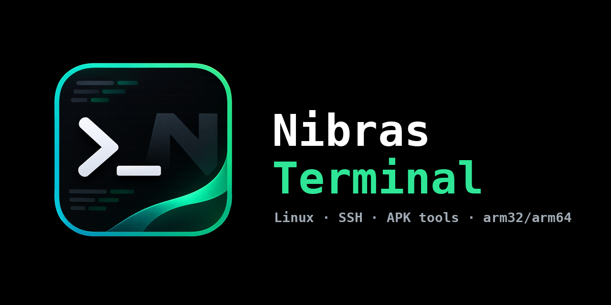

<p align="center">
  
</p>

<h1 align="center">Nibras Terminal</h1>

<p align="center"><b>A full Linux terminal for Android, in 19 languages.</b><br>
Alpine Linux out of the box · Debian, Ubuntu, Arch, Fedora, Kali on demand · code editor with LSP · APK studio · SSH · media tools</p>

<p align="center">
  <a href="docs/guide/en.md"></a>
  <a href="docs/guide/az.md"></a>
  <a href="docs/guide/tr.md"></a>
  <a href="docs/guide/ru.md"></a>
  <a href="docs/guide/ar.md"></a>
  <a href="docs/guide/fa.md"></a>
  <a href="docs/guide/ur.md"></a>
  <a href="docs/guide/fr.md"></a>
  <a href="docs/guide/de.md"></a>
  <a href="docs/guide/es.md"></a>
  <a href="docs/guide/pt.md"></a>
  <a href="docs/guide/it.md"></a>
  <a href="docs/guide/id.md"></a>
  <a href="docs/guide/ms.md"></a>
  <a href="docs/guide/zh.md"></a>
  <a href="docs/guide/ja.md"></a>
  <a href="docs/guide/ko.md"></a>
  <a href="docs/guide/hi.md"></a>
  <a href="docs/guide/bn.md"></a>
</p>

<p align="center">
  
  
  
  <a href="LICENSE"></a>
  
</p>

<p align="center">
  <a href="https://github.com/nibrascode/nibras-terminal/actions/workflows/debug-apk.yml"></a>
  <a href="https://github.com/nibrascode/nibras-terminal/actions/workflows/launch-test.yml"></a>
  <a href="https://github.com/nibrascode/nibras-terminal/actions/workflows/android-build-test.yml"></a>
  <a href="https://github.com/nibrascode/nibras-terminal/actions/workflows/proot-test.yml"></a>
  <a href="https://github.com/nibrascode/nibras-terminal/actions/workflows/distro-test.yml"></a>
</p>

<p align="center">
  
</p>

---

## ✨ What is it?

Nibras Terminal opens straight into a real terminal. It runs **Alpine Linux** without any setup, adds other Linux distributions when you ask, and ships a code editor, a file manager, an SSH client, APK build and edit tools, and media tools. The APK stays small (~20 MB) because heavy tools are installed on demand with `install <pack>`.

📖 **Read the full guide in your language:** [🌐 Guides in your language](#-guides-in-your-language)

## 🚀 Quick start

1. Download the latest APK from **Actions → Android package → artifact**.
2. Install it and allow "Install unknown apps".
3. Pick your language on the first launch (English is the default).
4. Start typing:

```sh
help                 # short list of commands
nibras               # menu of all Nibras tools
install              # every pack, with a description
install python       # add a pack
run hello.py         # run code in 30+ languages
install debian       # add Debian
customize            # look & feel menu
```

## 🧰 Features

| | Feature | Commands / where |
| --- | --- | --- |
| 🐧 | **Linux environments** | Alpine built in; Debian, Ubuntu, Arch, Fedora, Kali on demand; PRoot, no root needed |
| 📦 | **On-demand packs** | `install`, `install video`, `install apk`, `install python`, `pkg install <name>` |
| 💻 | **Programming** | `run <file>` for 30+ languages, project detection (Cargo, Go, npm, Gradle, CMake, Make) |
| 🧠 | **Editor + LSP** | syntax highlight, completion, diagnostics, hover, go-to-definition · `install lsp-python`, `lsp-java`, `lsp-kotlin`, `lsp-xml`, `lsp-ts`, `lsp-c` … |
| 📱 | **APK studio** | `nibras-apk new/wizard/build/run/sign`, decompile/rebuild, smali, split/APKS install, visual **resource editor** (`nibras-apk res`) |
| 🗂️ | **File manager** | `files`, archives, sharing, phone storage via `nibras-setup-storage` |
| 🔐 | **SSH** | hosts, keys, port forwards, jump hosts, Mosh, Telnet, SFTP, `nibras-sshd` |
| 🎬 | **Media & documents** | `video merge/cut/compress`, `audio`, `image`, `download <url>`, `pdf`, `ocr`, `office` |
| 🎨 | **Customization** | `theme`, `color`, `font`, `prompt`, `cursor`, `wallpaper`, `keys`, `motd`, `aliases`, `customize`, `reset-look` |
| 🌍 | **Languages** | 19 UI languages, RTL for Arabic/Persian/Urdu, `lang`, natural phrases like `türkçe yükle` |
| 🤖 | **Helpers** | `ask`, `explain`, `fix`, `recipes`, `learn`, voice commands, `llm` (offline AI) |
| 🛡️ | **Security** | fingerprint lock, `vault` (encrypted), `trash`, `snapshot` |
| ⚙️ | **Automation** | Tasker plugin, RUN_COMMAND intent, `cron`, `~/.nibras/boot`, home-screen widget |
| 🕌 | **Extras** | `quran`, `hadith`, `prayer`, `games`, `webterm`, split screen, floating window, XFCE desktop |

## 🎨 Colors in one line

```sh
theme dracula
color rainbow "Hello Nibras"
prompt powerline
font jetbrains-mono
```

## 🌐 Guides in your language

Every guide covers installation, basics, packs, distros, programming, the editor and LSP, files, SSH, APK tools, media, customization, language commands, permissions, troubleshooting and FAQ.

| | Guide | Language | |
| --- | --- | --- | --- |
| 🇬🇧 | [**English**](docs/guide/en.md) | English | |
| 🇦🇿 | [**Azərbaycanca**](docs/guide/az.md) | Azerbaijani | |
| 🇹🇷 | [**Türkçe**](docs/guide/tr.md) | Turkish | |
| 🇷🇺 | [**Русский**](docs/guide/ru.md) | Russian | |
| 🇸🇦 | [**العربية**](docs/guide/ar.md) | Arabic | RTL |
| 🇮🇷 | [**فارسی**](docs/guide/fa.md) | Persian | RTL |
| 🇵🇰 | [**اردو**](docs/guide/ur.md) | Urdu | RTL |
| 🇫🇷 | [**Français**](docs/guide/fr.md) | French | |
| 🇩🇪 | [**Deutsch**](docs/guide/de.md) | German | |
| 🇪🇸 | [**Español**](docs/guide/es.md) | Spanish | |
| 🇧🇷 | [**Português**](docs/guide/pt.md) | Portuguese | |
| 🇮🇹 | [**Italiano**](docs/guide/it.md) | Italian | |
| 🇮🇩 | [**Bahasa Indonesia**](docs/guide/id.md) | Indonesian | |
| 🇲🇾 | [**Bahasa Melayu**](docs/guide/ms.md) | Malay | |
| 🇨🇳 | [**简体中文**](docs/guide/zh.md) | Chinese (Simplified) | |
| 🇯🇵 | [**日本語**](docs/guide/ja.md) | Japanese | |
| 🇰🇷 | [**한국어**](docs/guide/ko.md) | Korean | |
| 🇮🇳 | [**हिन्दी**](docs/guide/hi.md) | Hindi | |
| 🇧🇩 | [**বাংলা**](docs/guide/bn.md) | Bengali | |

## 🏗️ Under the hood

- Package `com.nibras.terminal`, Kotlin, minimum Android 8 (API 26), one universal APK for **arm64-v8a** and **armeabi-v7a**.
- Full VT100/xterm terminal with 256 colors and truecolor, scrollback, pinch-to-zoom and text selection.
- Alpine 3.24 is unpacked from the APK on first launch; other systems are downloaded and checksum-verified ([`catalog/manifest.json`](catalog/manifest.json)).
- Phone APIs (`nibras-*`): battery, clipboard, notifications, camera, microphone, location, sensors, contacts, SMS and more. Permissions are asked only when a command needs them.
- Web terminal: [nibrascode.github.io/nibras-terminal](https://nibrascode.github.io/nibras-terminal/) (a separate engine for the browser).

## 📚 More docs

- [`AGENTS.md`](AGENTS.md) — full command reference, also for AI agents.

## 📄 License

[MIT](LICENSE) © 2026 nibrascode

## 🙏 Open-source credits

- terminal-emulator / terminal-view libraries — Apache-2.0
- PRoot — GPL-2.0
- Alpine Linux — MIT and other open-source licenses of its packages
