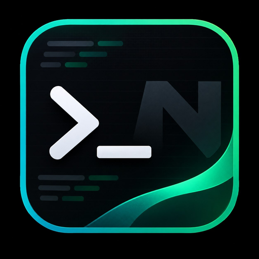
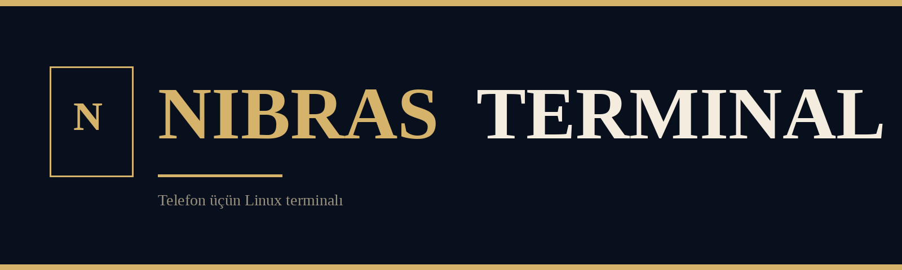

<p align="center">
  
</p>

<p align="center">
  
</p>

<p align="center">
  <a href="https://nibrascode.github.io/nibras-terminal/"><b>Terminalı aç</b></a>
  &nbsp;·&nbsp; Android 8+ &nbsp;·&nbsp; arm64
</p>

Nibras Terminal telefon üçün Linux terminalıdır. Vebdə brauzerdən açılır, telefonda isə öz APK-sı kimi quraşır. İkisi eyni addır, amma eyni mühərrik deyil: veb əmri telefon shell-ində, telefon əmri vebdə işlək sayılmır.

Üç yol, eyni iş:

| Yol | Nə edir |
| --- | --- |
| Əmr | `nibras install alpine`, `python3 main.py`, `git status` |
| Düymə | Eyni əmri seçimdən işlədir. Düymə ayrıca sehr deyil |
| Xana | Token, şifrə və layihə adı əmr sətrinə yazılmır |

Tam istifadə qaydası, süni zəka üçün də: [`AGENTS.md`](AGENTS.md)

## Veb terminal

Ünvan: [nibrascode.github.io/nibras-terminal](https://nibrascode.github.io/nibras-terminal/)

Əvvəl bir mühit seçilir. Eyni anda yalnız biri saxlanır.

```
nibras install alpine
nibras install debian
nibras install ubuntu
```

Debian və Ubuntu böyükdür, təsdiq xanası açılır. Sonra alət seçilir: `python`, `node`, `php`, `git`, `build`. Seçilməyən alət işləmir. `python3`, `node`, `php`, `git` və `gcc` yalnız öz paketi seçildikdən sonra açılır.

Shell adi Linux əmrlərini qəbul edir: `ls`, `cd`, `cat`, `mkdir`, `rm`, `cp`, `mv`, `grep`, `find`, `tar`, `zip`, `curl`, `ssh`, `make`, `sqlite3`, `systemctl`. Boru, yönləndirmə, `&&`, `$()` və `set -e` işləyir. Tam siyahı terminalda `help`dir. Siyahıda olmayan əmr mövcud sayılmır.

Dörd dil var: Azərbaycan, Türk, İngilis, Rus. Dil düyməsinə toxunanda yalnız seçilən dil yüklənir. Menyular və tətbiqin öz yazısı həmin dilə keçir. Linux proqramının öz çıxışı tərcümə olunmur.

## Telefon tətbiqi

Paket `com.nibras.terminal`. Kotlin. Minimum Android 8 (API 26). Bir universal APK həm **arm64-v8a**, həm də **armeabi-v7a** (32-bit ARM) üçündür. Tətbiq işə düşəndə hansı ABI ilə qurulduğunu (`Process.is64Bit()`) yoxlayır və uyğun PRoot ilə Alpine-i seçir.

Tətbiq açılan kimi tam ekran qara terminal gəlir. Bu, Termux-un terminal emulyatorudur (`terminal-view` / `terminal-emulator` v0.118.1, Apache-2.0): VT100/xterm, 256 rəng və truecolor, scrollback, iki barmaqla böyütmə, mətn seçimi, URL seçimi. Aşağıdakı nav tabları yoxdur. Sessiyalar, mühitlər və ayarlar soldakı çəkmədə (drawer) durur: ekranın sol kənarından çəkin və ya extra-keys sırasında `☰` düyməsinə basın.

- Bir neçə sessiya. Sessiyanın adını dəyişmək və bağlamaq üçün üzərinə uzun basın. "Yeni sessiya" düyməsinə uzun basanda mühit seçilir: Alpine, Debian, Ubuntu və ya Android shell.
- Extra-keys: `ESC / - HOME ↑ END PGUP` və `TAB CTRL ALT ← ↓ → PGDN`. CTRL/ALT yapışqandır. Sıranı `~/.nibras/extra-keys` (və ya `~/.termux/extra-keys`) ilə dəyişmək olur. Sıranı sola sürüşdürəndə mətn sahəsi açılır.
- Səs düymələri Termux kimidir: aşağı səs düyməsi CTRL, yuxarı səs düyməsi isə extra-keys rolunu oynayır. Fiziki klaviaturada Ctrl+Alt qısayolları işləyir.
- 12 rəng sxemi var. `~/.nibras/colors.properties` və `~/.nibras/font.ttf` fayllarını özünüz qoya bilərsiniz.
- Ön plan xidməti sessiyaları açıq saxlayır. Bildirişdə "Çıx" və wakelock düymələri var. Açılış skriptləri `~/.nibras/boot/` qovluğundadır. Ana ekran vidceti `~/.shortcuts` skriptlərini işlədir. "Paylaş" menyusundan gələn fayl `~/downloads` qovluğuna düşür.
- Dil seçimi: AZ, TR, EN, RU.

Alpine 3.24.4 hər iki ABI üçün APK-nın içindədir və ilk açılışda simvolik keçidlər və icra icazələri ilə birlikdə açılır. `pkg install ...` əmri apk və apt üçün Termux üslubunda ön tərəfdir. `/root/storage` telefon yaddaşına bağlıdır (`termux-setup-storage`).

Telefon əmrləri: `termux-*` və `nibras-*` adları eyni körpüyə gedir (lokal soket, təsadüfi token `/etc/nibras/api` faylında). Batareya, lövhə, bildiriş, toast, titrəmə, fənər, işıq, səs, kamera, mikrofon, yer, sensor, barmaq izi, kontakt, zəng, SMS, `termux-open`, `termux-wake-lock` və `termux-setup-storage` var. Kamera, mikrofon, yer, kontakt və SMS icazə istəyir. İcazə verilməyibsə nəticə uydurulmur.

## Nə içindədir

| Seçim | arm64-v8a | armeabi-v7a |
| --- | --- | --- |
| Alpine 3.24.4 | APK-nın içində | APK-nın içində |
| Debian stable | yüklənir (payloads-0.1) | yüklənir (payloads-0.2, armhf) |
| Ubuntu 24.04 | yüklənir | yüklənir (armhf) |
| Python 3.12 | yüklənir | yüklənir (armv7) |
| Node | yüklənir | v22 (Node 23+ armv7 üçün yoxdur, `libatomic1` lazımdır) |
| PRoot | `libproot.so` + loader + loader32 | `libproot.so` + loader |

Bu ABI-də işləməyən paket siyahıda "<abi> üçün mövcud deyil" kimi görünür, yükləmə düyməsi isə olmur.

Siyahı [`catalog/manifest.json`](catalog/manifest.json) faylındadır. Checksum uyğun gəlməyən fayl silinir.

## APK və AAB

Paket veb terminaldan qurulur, telefondan yox.

```
nibras apk build
nibras apk status
nibras apk download
nibras aab build
nibras aab status
nibras aab download
nibras sign
nibras sign status
nibras sign download
```

SDK `35`, `34` və ya `33` seçilir: `nibras apk build 34`, `nibras sign 33`. Java 17-dir. `status` `versionCode` göstərir. `download` zip vermir. Telefon `nibras-terminal-<version>.apk` alır və açanda quraşdırma çıxır. `nibras sign download` həm imzalı APK, həm AAB verir.

İlk `nibras sign` release açarını bir dəfə yaradır və saxlayır. Sonrakı qurmalar eyni açarla imzalanır, ona görə Play yeniləməni qəbul edir. Şifrə terminalda görünmür və endirilən faylın içinə qoyulmur. `versionCode` hər qurmada artır, yeni paket köhnənin üstünə quraşır.

Debug APK və debug AAB Android-in debug açarı ilə imzalanır. Qurucu imzanı yoxlamadan faylı vermir.

## Nəyi yazmaq olmaz

Token, keystore və imza şifrəsi çıxışa, commit-ə və sənədə yazılmır. Açar hər qurmada yenidən yaradılmır. Alpine ayrıca yükləmə deyil. Debian, Ubuntu, Python və Node APK-nın içində deyil. Vebdəki `nibras apk` telefon shell-inin əmri deyil. Telefonun `nibras-battery-status` əmri veb terminalın əmri deyil.

## Android tətbiqi: nə var

Tətbiq kiçikdir (~20 MB). Alətlər içinə qoyulmur: `install <paket>` yazanda yüklənir.

| Bölmə | Əmr / yer |
| --- | --- |
| Paketlər | `install` (siyahı), `install video`, `install apk`, `install python` … · soldakı menyuda **Mağaza** |
| Menyu | `nibras` — bütün alətlər AZ/TR/EN/RU |
| Media | `video merge a.mp4 b.mp4`, `video cut`, `video compress`, `audio`, `image resize`, `download <url>` |
| Sənəd | `pdf merge/split/compress/lock`, `ocr şəkil.jpg`, `office qeyd.md qeyd.docx`, `notes` |
| Şəbəkə | `web .`, `share webdav /sdcard`, `webterm` (kompüter brauzerində terminal), `net speed`, `qr` |
| Proqramlaşdırma | redaktor (Run düyməsi), `py`, `node`, `install dev`, `nibras apk new/build/decompile/sign` |
| SSH | SSH hostları (açarlar, port yönləndirmə, jump host, mosh, telnet, SFTP), `nibras-sshd` |
| Sistem | fayl meneceri, ekranı bölmək, üzən pəncərə, masaüstü (XFCE/noVNC), root shell, `nibras-adb`, `nibras-rish` |
| Köməkçi | `ask "…"`, `explain <əmr>`, `fix`, `recipes`, `learn`, əmr təklifləri, səslə əmr |
| Təhlükəsizlik | barmaq izi ilə kilid, `vault` (şifrəli seyf), `trash`, `snapshot` |
| Avtomatlaşdırma | Tasker plugin, RUN_COMMAND intent, `cron`, `nibras-job-scheduler`, `~/.nibras/boot` |
| Digər | `llm` (oflayn AI), `quran`, `hadith`, `prayer`, `games`, `record`, `clip`, `plugin` |

Hər tətbiqdən götürülənlərin yoxlama siyahısı: [`docs/TEACHERS.md`](docs/TEACHERS.md)
